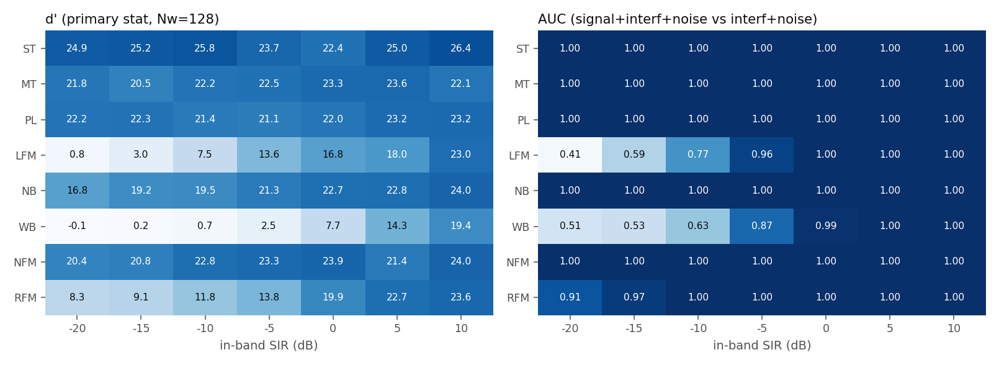
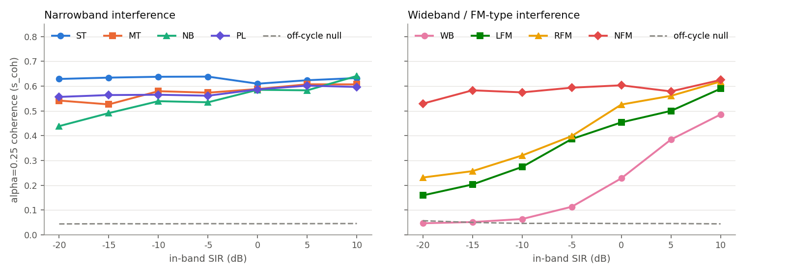
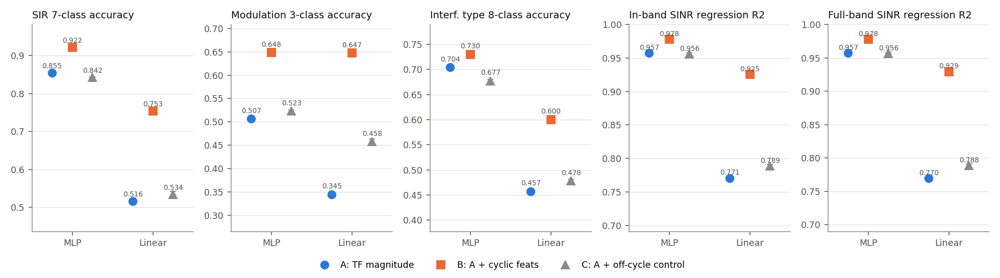
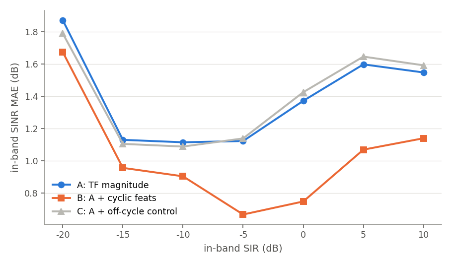

# M2-0 循环平稳（谱相关）特征的可分辨性分析

> 纯 CPU 实验，脚本 `new/analysis/m2_0_cyclo.py`（固定种子，可复现）。数据：`new/data/v2`，test 全部 6720 条（未抽样；每个 类型×调制×SIR 格 40 条）用于 Q1/Q2/Q5；探针用 train+test 共 13440 条做 5 折交叉验证（按 clean_id 分组）。

## 0. 结论先行

**判定（按预先固定的判据）：通过。**

- 判据 (i) 满足：窄带型干扰里最好的格子是 ST @ SIR=-10 dB，d'=25.8（要求 ≥3）；ST/MT/PL/NB 在 **所有** SIR 档（含 -20 dB）d'都 ≥16.8，AUC≈1.00。
- 判据 (ii) 满足：探针 MLP 上 B 相对 A，SIR 7 分类准确率 +0.067±0.003（阈值 +0.02 且 >2SE，达标）；带内 SINR 回归 R² +0.020±0.001（阈值 +0.03 且 >2SE，未达标）。对照 C（A+同维度的离循环特征）相对 A 的增量为 SIR 准确率 -0.013±0.004、R² -0.001±0.001，说明增量来自"循环性"本身而不是多了几十维谱统计。

最关键的 3 个数字：

1. 频带分辨的 α=0.25 相干特征对 ST/MT/PL/NB 在 SIR=-20 dB 的 d'≈17–25（AUC=1.00）；整窗口循环矩同一格 d' 只有 0.1–1.0（AUC 0.80–0.88）。
2. 探针（MLP）SIR 7 分类准确率 A→B：0.855±0.003 → 0.922±0.002；带内 SINR 回归 R²：0.957±0.001 → 0.978±0.001（MAE 1.39 → 1.02 dB）。
3. 对宽带 WB 和扫频 LFM，特征在 SIR≤-10 dB 基本失效（WB d'≤0.7；LFM d'=0.8/3.0/7.5 @ -20/-15/-10 dB）——这两类恰好是"干扰覆盖信号带边"的类型。

通俗地说：这个特征本质上是在信号带边（归一化频率 ±0.125 附近）找"符号率留下的指纹"，并用局部相干系数把干扰功率"除掉"。对窄带干扰，干扰几乎不碰带边，指纹清晰可见；对宽带干扰，带边被淹没，指纹消失。

### 对任务书"理论要点"的核实与修正（以数据为准）

| 理论要点 | 核实结果 |
|---|---|
| S^α0(f) 只存在于 α0=0.25，支撑 |f|≤β/8 | **成立**。α=0.25 处特征强（见 §2）；α=0.5 处功率归一化特征 ≈ 8.4e-05，离循环处 ≈ 0.02–0.1，说明 **没有 2 次谐波**：RRC 带宽 (1+β)/8≤0.1875<0.25，S^0.5 的两个谱支不重叠，理论上就是 0，不能当作循环特征用（只能当零假设）。 |
| 特征集中在"基带 DC 附近一个窄区域" | **需修正**：|f|≤β/8 是谱相关函数的 **频率变量 f**（两个谱分量的中点），实际取用的谱 bin 是 X(f+0.125) 与 X(f−0.125)，即位于 **信号带边 ±0.125±β/8**（RRC 滚降区），而不是 DC。因此"干扰频率落在 |f|≤β/8 内就被破坏"是错的：被污染的是干扰落在 ±0.125±β/8 的情形（见 §3.3，实测 DC 区命中的样本检测反而不差）。 |
| 整窗口循环矩在 SIR≤-15 dB 几乎测不出 | **粗查数值复现**（干净 0.120；混合 0.003/0.005/0.012/0.029/0.058；样本间标准差 0.005–0.023）。但"测不出"需细化：与纯干扰+噪声相比 AUC 仍有 0.87–0.97（-20/-15 dB, ST），只是 d'小（1.0/2.4），动态范围被干扰功率稀释；频带分辨 + 相干系数归一化后 d' 提高一个数量级。 |
| 共轭版本利用 BPSK 非圆特性 | **成立但需 CFO 搜索**：BPSK 的共轭循环频率是 0.25+2·CFO（|CFO|≤0.002 → 偏移最多 0.004，约 0.5 个 FFT bin），固定在 0.25 时特征几乎消失；沿帧序列做过采样 FFT 在 ±0.004 内搜索后，BPSK 共轭相干系数 ≈ 0.43（β<0.375）/0.83（β≥0.375），QPSK/16QAM 无共轭特征（≈零假设）。 |
| 窗口 2560 点是否足够 | 足够（见 §5）。 |

### 推荐特征集（后续接入模型用）

- 估计器：Nw=128 汉宁窗、hop=32 的时间平滑谱相关；f 取 |f|≤0.0625 共 17 个 bin（f=j/128, j=-8..8），按 5 个子带分组。
- α 集合：**α=0.25 非共轭**（主）、**α=0.25 共轭，带 ±0.004 的 CFO 搜索**（BPSK 专用）、**α=0 共轭**（非圆性，BPSK 专用，已含在 B 里）。零假设参照：近邻离循环 α∈{0.1875, 0.21875, 0.28125, 0.3125} 的同一统计量的均值（用来做"减去基线"）。α=0.5 及其他谐波不要用。
- 每个 (α, 共轭类型) 取 8 维：相干系数相位对齐求和 s_coh、幅度平均 s_inc、功率归一化 s_pow（|ΣS|/(J·平均功率)，这是"信号功率占总功率"的估计）、5 个子带的相干系数幅度；取 log(x+1e-3)。
- 最终 B_cyc = 3×8（α=0.25 非共轭 / α=0.25 共轭 / α=0 共轭）+ 2×3（离循环基线 s_coh/s_inc/s_pow，非共轭与共轭）+ 2×5（离循环基线子带）+ 4（α=0.5 参照）= **44 维**；最小版本（仅 α=0.25 非共轭+共轭，16 维）见 §4.3。
- 只用 s_pow（1 维）也能当粗略 SIR 计：按干扰类型，log s_pow 与带内 SINR 的相关系数 0.95–0.97（WB 例外 0.84），见 §4.2。

## 1. 方法口径

- 谱相关：时间平滑法。z=I+jQ，Nw∈{64,128}（周期汉宁窗），hop=Nw/4；S(f)=⟨X_k(f+α/2)X_k*(f−α/2)⟩_k（非共轭）、⟨X_k(α/2+f)X_k(α/2−f)⟩_k（共轭）；α=m/Nw（m 取偶数，最近网格）。α 取 0.25、0.5、0、近邻离循环 {0.1875,0.21875,0.28125,0.3125}（≈任务书的 0.19/0.31，加两个更近的）、远离循环 0.40625（≈0.4）。
- 标量统计量（|f|≤0.0625，J 个 bin）：`s_coh`=|Σ_f S/√(S0(f+)S0(f−))|/J（局部相干系数，相位对齐后相加）；`s_inc`=相干系数幅度的平均；`s_pow`=|Σ_f S|/(J·P̄)，P̄ 为窗内全部 bin 平均功率（功率归一化）。
- d'=（α0 处均值 − 同一格内同样本在近邻离循环 α 处的均值）/离循环处标准差；AUC=P(混合信号的 α0 特征 > 纯干扰+噪声（noisy−clean）的 α0 特征)。每格 = 一个干扰类型 × 一个 SIR，合并 3 种调制与 2 种滚降共 120 条。
- 注意 α=0 的非共轭相干系数按定义恒为 1（只是功率谱），只作对照。干净信号在 α=0.5 处 s_coh 数值上没有意义（分母≈0，数值泄漏），故 α=0.5 一律用 s_pow 看。
- TF 特征 A：与 `TF_Expert` 同口径——I、Q 两通道分别 torch.stft（n_fft=128, hop=32, 汉宁窗）取幅度，样本先按 RMS 归一，平均池化到 16(频)×8(时)×2(通道)=256 维，取 log。B = A + B_cyc（44 维）；C（对照）= A + 同形状的 α=0.28125/0.21875 离循环特征（32 维）。
- 探针：torch CPU，MLP（256-128，GELU，dropout 0.2，AdamW，60 epoch）与线性模型（softmax/线性回归）；特征按训练折标准化；超参只依据 A 的设定，B、C 沿用。5 折按 clean_id 分组（本数据每条样本的 clean_id 唯一，等价于普通 5 折）。
- 回归目标：带内 SINR(dB)=10log10(P_clean_带内 / P_(noisy−clean)_带内)，带内 = |f|≤(1+β)/8（主）；另报全带时域 SINR（补充）。

## 2. Q1 干净信号的 α0 特征有多强

**结论：α=0.25 的非共轭特征在干净信号上很强，与调制方式无关（QPSK/BPSK/16QAM 一致），只随滚降 β 变化；共轭特征只有 BPSK 有；α=0.5 为 0。**

| 调制 | β 区间 | n | s_coh@0.25 非共轭 | 离循环 s_coh | s_pow@0.25 非共轭 | 离循环 s_pow | s_pow@0.5 | s_coh@0.25 共轭 | 离循环(共轭) s_coh | s_pow@0.25 共轭 |
|---|---|---|---|---|---|---|---|---|---|---|
| QPSK | 0.250-0.375 | 1086 | 0.44±0.13 | 0.039 | 0.75 | 0.049 | 9.1e-05 | 0.14 | 0.14 | 0.12 |
| QPSK | 0.375-0.500 | 1154 | 0.85±0.09 | 0.038 | 1.06 | 0.050 | 7.8e-05 | 0.13 | 0.14 | 0.15 |
| BPSK | 0.250-0.375 | 1075 | 0.44±0.13 | 0.056 | 0.75 | 0.070 | 9.0e-05 | 0.43 | 0.12 | 0.72 |
| BPSK | 0.375-0.500 | 1165 | 0.85±0.09 | 0.055 | 1.05 | 0.072 | 7.6e-05 | 0.83 | 0.12 | 1.01 |
| 16QAM | 0.250-0.375 | 1126 | 0.44±0.13 | 0.041 | 0.74 | 0.054 | 9.0e-05 | 0.14 | 0.14 | 0.13 |
| 16QAM | 0.375-0.500 | 1114 | 0.85±0.09 | 0.041 | 1.06 | 0.057 | 7.7e-05 | 0.14 | 0.14 | 0.16 |

（Nw=128，干净信号。Nw=64 的结果见 JSON 缓存；s_coh 在 β 小时偏小，是因为固定带 |f|≤0.0625 里只有 |f|≤β/8（0.031~0.0625）有支撑，其余 bin 是 0/0 噪声。）

- 整窗口循环矩 |R(0.25,0)|/总功率：干净 0.120（与任务书 0.12 一致）。
- 非共轭：β 越大特征越强且宽（β=0.5 时在整个 |f|≤0.0625 内相干系数≈0.85，β=0.25 时只在 ±0.031 内有，平均 0.44）。三种调制数值几乎相同，说明它测的是 **符号率/脉冲成形**，不是调制。
- 共轭：BPSK 的 α=0.25 共轭特征与非共轭一样强（β≥0.375 时 0.83），QPSK 与 16QAM ≈ 零假设。α=0 共轭 s_pow（非圆性）BPSK ≈ 3.9，其余 ≈ 0.5，可当 BPSK 判别特征。

各 α 上的平均特征（Nw=128，非共轭，全部 test 样本）：

| α 名 | 干净 s_pow | 混合 s_pow | 混合 s_coh | 纯干扰+噪声 s_coh |
|---|---|---|---|---|
| a025 | 0.905 | 0.319 | 0.486±0.221 | 0.054 |
| a05 | 8.35e-05 | 0.00118 | 0.057±0.064 | 0.056 |
| a0 | 4 | 4.66 | 1.000±0.000 | 1.000 |
| off1 | 0.116 | 0.0735 | 0.043±0.023 | 0.047 |
| off2 | 0.0893 | 0.0527 | 0.044±0.024 | 0.051 |
| off3 | 0.0241 | 0.0199 | 0.048±0.029 | 0.057 |
| off4 | 0.00638 | 0.0117 | 0.050±0.034 | 0.059 |
| far | 0.000203 | 0.00305 | 0.056±0.062 | 0.061 |

（a025=0.25，a05=0.5，a0=0（相干系数恒为 1），off1..4=0.1875/0.21875/0.28125/0.3125，far=0.40625。）

## 3. Q2 在混合信号上的可检测性

### 3.1 主统计量 d' / AUC（Nw=128，非共轭 α=0.25，s_coh；合并 3 种调制）

| 类型 \ SIR(dB) | -20 | -15 | -10 | -5 | 0 | 5 | 10 |
|---|---|---|---|---|---|---|---|
| ST | 24.9 / 1.00 | 25.2 / 1.00 | 25.8 / 1.00 | 23.7 / 1.00 | 22.4 / 1.00 | 25.0 / 1.00 | 26.4 / 1.00 |
| MT | 21.8 / 1.00 | 20.5 / 1.00 | 22.2 / 1.00 | 22.5 / 1.00 | 23.3 / 1.00 | 23.6 / 1.00 | 22.1 / 1.00 |
| PL | 22.2 / 1.00 | 22.3 / 1.00 | 21.4 / 1.00 | 21.1 / 1.00 | 22.0 / 1.00 | 23.2 / 1.00 | 23.2 / 1.00 |
| LFM | 0.8 / 0.41 | 3.0 / 0.59 | 7.5 / 0.77 | 13.6 / 0.96 | 16.8 / 1.00 | 18.0 / 1.00 | 23.0 / 1.00 |
| NB | 16.8 / 1.00 | 19.2 / 1.00 | 19.5 / 1.00 | 21.3 / 1.00 | 22.7 / 1.00 | 22.8 / 1.00 | 24.0 / 1.00 |
| WB | -0.1 / 0.51 | 0.2 / 0.53 | 0.7 / 0.63 | 2.5 / 0.87 | 7.7 / 0.99 | 14.3 / 1.00 | 19.4 / 1.00 |
| NFM | 20.4 / 1.00 | 20.8 / 1.00 | 22.8 / 1.00 | 23.3 / 1.00 | 23.9 / 1.00 | 21.4 / 1.00 | 24.0 / 1.00 |
| RFM | 8.3 / 0.91 | 9.1 / 0.97 | 11.8 / 1.00 | 13.8 / 1.00 | 19.9 / 1.00 | 22.7 / 1.00 | 23.6 / 1.00 |

格式：d' / AUC。结论（按类型）：

- **ST/MT/PL/NB**（窄带类）：所有 SIR 档 d'=22–26/21–24/17–24/21–23，AUC=1.00（NB 在 -20 dB 略低 16.8，AUC 0.998）——**SIR 低到 -20 dB 特征依然清晰，且几乎不随 SIR 变化**（干扰集中在带内某处，不碰带边 bin，局部相干系数把它"除掉"）。
- **NFM**：与窄带类同级（d'≥20）；**RFM**：SIR 低时变差（d'=8.3 @ -20 dB，AUC 0.91），≥-10 dB 后 AUC=1.00。
- **LFM**（扫频，周期内扫过整个频带，包括带边）：d'=0.8/3.0/7.5/13.6 @ -20/-15/-10/-5 dB，AUC=0.41/0.59/0.77/0.96，≤-15 dB 基本测不出。
- **WB**（宽带，覆盖全频带）：d'≈0（AUC≈0.5）直到 SIR=-5 dB（d'=2.5）；到 0 dB 才有 d'=7.7，与"宽带较差"的预期一致，而且比预期更差——SIR≤-10 dB 完全无效。
- 窄带类 d'整体 >20 的数值很大，是因为同一样本的离循环零假设标准差很小（≈0.02），不要把"d'=25"理解成"某个下游增益"。

### 3.2 其他统计量变体（敏感性）

**Nw=128, s_pow（功率归一化）**

| 类型 \ SIR(dB) | -20 | -15 | -10 | -5 | 0 | 5 | 10 |
|---|---|---|---|---|---|---|---|
| ST | 1.5 / 1.00 | 3.1 / 1.00 | 6.0 / 1.00 | 8.8 / 1.00 | 11.5 / 1.00 | 13.2 / 1.00 | 14.3 / 1.00 |
| MT | 0.3 / 0.98 | 0.7 / 1.00 | 1.3 / 1.00 | 2.0 / 1.00 | 7.6 / 1.00 | 11.3 / 1.00 | 11.6 / 1.00 |
| PL | 0.5 / 0.98 | 1.1 / 1.00 | 2.1 / 1.00 | 4.5 / 1.00 | 7.5 / 1.00 | 9.9 / 1.00 | 12.0 / 1.00 |
| LFM | 0.2 / 0.91 | 0.8 / 1.00 | 2.2 / 1.00 | 4.3 / 1.00 | 7.4 / 1.00 | 9.5 / 1.00 | 12.5 / 1.00 |
| NB | 0.3 / 0.98 | 1.1 / 1.00 | 2.5 / 1.00 | 4.0 / 1.00 | 7.9 / 1.00 | 10.5 / 1.00 | 12.7 / 1.00 |
| WB | 0.1 / 0.50 | 0.1 / 0.48 | 0.5 / 0.57 | 1.9 / 0.87 | 5.5 / 0.99 | 10.7 / 1.00 | 13.2 / 1.00 |
| NFM | 0.5 / 1.00 | 1.4 / 1.00 | 3.0 / 1.00 | 5.0 / 1.00 | 8.7 / 1.00 | 11.1 / 1.00 | 12.7 / 1.00 |
| RFM | 0.6 / 0.99 | 1.2 / 1.00 | 2.9 / 1.00 | 4.5 / 1.00 | 8.5 / 1.00 | 11.1 / 1.00 | 14.0 / 1.00 |

**Nw=128, s_inc（不相位对齐）**

| 类型 \ SIR(dB) | -20 | -15 | -10 | -5 | 0 | 5 | 10 |
|---|---|---|---|---|---|---|---|
| ST | 25.1 / 1.00 | 26.9 / 1.00 | 25.5 / 1.00 | 26.1 / 1.00 | 25.5 / 1.00 | 27.6 / 1.00 | 25.8 / 1.00 |
| MT | 22.0 / 1.00 | 20.8 / 1.00 | 24.0 / 1.00 | 23.3 / 1.00 | 24.2 / 1.00 | 24.9 / 1.00 | 25.0 / 1.00 |
| PL | 23.0 / 1.00 | 22.9 / 1.00 | 22.8 / 1.00 | 22.5 / 1.00 | 23.5 / 1.00 | 23.9 / 1.00 | 25.3 / 1.00 |
| LFM | 0.7 / 0.39 | 2.1 / 0.53 | 5.1 / 0.71 | 11.9 / 0.92 | 17.3 / 1.00 | 19.8 / 1.00 | 25.2 / 1.00 |
| NB | 18.0 / 1.00 | 21.1 / 1.00 | 21.5 / 1.00 | 22.3 / 1.00 | 23.1 / 1.00 | 24.9 / 1.00 | 24.5 / 1.00 |
| WB | -0.0 / 0.51 | 0.1 / 0.52 | 0.5 / 0.64 | 2.1 / 0.84 | 7.1 / 1.00 | 15.0 / 1.00 | 19.4 / 1.00 |
| NFM | 22.9 / 1.00 | 23.5 / 1.00 | 23.6 / 1.00 | 23.5 / 1.00 | 27.5 / 1.00 | 25.8 / 1.00 | 25.3 / 1.00 |
| RFM | 7.1 / 0.89 | 8.1 / 0.96 | 12.0 / 1.00 | 15.2 / 1.00 | 21.1 / 1.00 | 23.0 / 1.00 | 23.7 / 1.00 |

**Nw=64, s_coh**

| 类型 \ SIR(dB) | -20 | -15 | -10 | -5 | 0 | 5 | 10 |
|---|---|---|---|---|---|---|---|
| ST | 6.9 / 1.00 | 7.0 / 1.00 | 7.1 / 1.00 | 7.1 / 1.00 | 7.1 / 1.00 | 7.2 / 1.00 | 7.2 / 1.00 |
| MT | 5.9 / 1.00 | 5.8 / 1.00 | 6.2 / 1.00 | 6.1 / 1.00 | 6.5 / 1.00 | 6.9 / 1.00 | 7.1 / 1.00 |
| PL | 6.1 / 1.00 | 6.4 / 1.00 | 6.2 / 1.00 | 6.4 / 1.00 | 6.8 / 1.00 | 6.8 / 1.00 | 7.0 / 1.00 |
| LFM | 1.0 / 0.45 | 2.7 / 0.64 | 4.2 / 0.81 | 5.6 / 0.97 | 6.4 / 1.00 | 7.1 / 1.00 | 7.0 / 1.00 |
| NB | 5.2 / 0.99 | 5.8 / 1.00 | 6.4 / 1.00 | 6.5 / 1.00 | 6.6 / 1.00 | 6.6 / 1.00 | 7.3 / 1.00 |
| WB | 0.6 / 0.50 | 0.8 / 0.52 | 1.3 / 0.62 | 3.3 / 0.88 | 7.1 / 0.99 | 9.2 / 1.00 | 8.3 / 1.00 |
| NFM | 6.2 / 1.00 | 6.5 / 1.00 | 6.6 / 1.00 | 6.5 / 1.00 | 6.6 / 1.00 | 6.8 / 1.00 | 7.2 / 1.00 |
| RFM | 3.2 / 0.90 | 4.0 / 0.98 | 4.9 / 1.00 | 5.9 / 1.00 | 6.6 / 1.00 | 7.0 / 1.00 | 7.2 / 1.00 |

**Nw=128 共轭 s_coh（仅 BPSK，40 条/格）**

| 类型 \ SIR(dB) | -20 | -15 | -10 | -5 | 0 | 5 | 10 |
|---|---|---|---|---|---|---|---|
| ST | 19.5 / 1.00 | 18.7 / 1.00 | 18.3 / 1.00 | 16.8 / 1.00 | 17.2 / 1.00 | 16.3 / 1.00 | 17.4 / 1.00 |
| MT | 14.1 / 1.00 | 16.8 / 1.00 | 19.2 / 1.00 | 16.5 / 1.00 | 17.3 / 1.00 | 17.9 / 1.00 | 20.0 / 1.00 |
| PL | 6.9 / 0.96 | 13.5 / 0.98 | 7.1 / 0.99 | 9.9 / 0.98 | 15.3 / 1.00 | 15.2 / 1.00 | 15.3 / 1.00 |
| LFM | 1.0 / 0.48 | 2.2 / 0.55 | 4.4 / 0.66 | 11.6 / 0.81 | 12.4 / 0.95 | 14.9 / 1.00 | 17.6 / 0.99 |
| NB | 14.8 / 0.95 | 14.9 / 0.96 | 18.9 / 0.99 | 17.1 / 0.97 | 17.1 / 1.00 | 17.7 / 1.00 | 19.6 / 1.00 |
| WB | 0.0 / 0.48 | -0.1 / 0.49 | 0.3 / 0.55 | 1.3 / 0.67 | 4.6 / 0.90 | 9.6 / 0.99 | 13.5 / 1.00 |
| NFM | 14.4 / 1.00 | 14.9 / 1.00 | 16.4 / 1.00 | 18.5 / 1.00 | 15.6 / 1.00 | 17.1 / 1.00 | 19.7 / 1.00 |
| RFM | 4.7 / 0.87 | 4.7 / 0.84 | 6.0 / 0.83 | 9.4 / 0.92 | 15.8 / 0.99 | 16.6 / 1.00 | 18.7 / 1.00 |

**整窗口循环矩 |R(0.25,0)|/P（零假设取同样本近邻离循环 α）**

| 类型 \ SIR(dB) | -20 | -15 | -10 | -5 | 0 | 5 | 10 |
|---|---|---|---|---|---|---|---|
| ST | 1.0 / 0.87 | 2.4 / 0.97 | 4.4 / 0.99 | 7.6 / 1.00 | 10.6 / 1.00 | 12.8 / 1.00 | 14.1 / 1.00 |
| MT | 0.1 / 0.80 | 0.7 / 0.96 | 1.4 / 1.00 | 2.0 / 1.00 | 7.5 / 1.00 | 11.3 / 1.00 | 12.1 / 1.00 |
| PL | 0.4 / 0.88 | 1.0 / 0.97 | 2.1 / 1.00 | 4.5 / 1.00 | 7.8 / 1.00 | 10.1 / 1.00 | 12.0 / 1.00 |
| LFM | 0.2 / 0.90 | 0.8 / 0.96 | 2.2 / 1.00 | 4.5 / 1.00 | 7.4 / 1.00 | 9.7 / 1.00 | 12.7 / 1.00 |
| NB | 0.3 / 0.85 | 0.9 / 0.95 | 2.4 / 1.00 | 3.9 / 1.00 | 8.2 / 1.00 | 10.6 / 1.00 | 13.4 / 1.00 |
| WB | 0.1 / 0.50 | 0.1 / 0.49 | 0.4 / 0.56 | 1.7 / 0.87 | 5.1 / 0.99 | 9.9 / 1.00 | 12.8 / 1.00 |
| NFM | 0.4 / 0.87 | 1.2 / 0.97 | 2.9 / 1.00 | 5.0 / 1.00 | 8.7 / 1.00 | 10.9 / 1.00 | 12.4 / 1.00 |
| RFM | 0.4 / 0.90 | 1.0 / 0.96 | 2.7 / 1.00 | 4.5 / 1.00 | 8.7 / 1.00 | 11.2 / 1.00 | 13.8 / 1.00 |

读法：①功率归一化 s_pow 的 d'随 SIR 单调变化（窄带类 -20→10 dB 约 1.5→14），因为它的分母是含干扰的总功率——所以 **s_pow 携带 SIR 信息，s_coh 携带"信号是否存在/带边是否干净"的信息**，二者互补；②Nw=64 的 d'比 128 低 3 倍左右（频率分辨不足，β=0.25 时只有 ±2 个 bin 在支撑内）；③整窗口矩在窄带类 AUC 仍高（≥-15 dB 时 ≥0.96），但 d'只有 1~4，且 WB 同样失效；④共轭特征在 BPSK 上和非共轭同级，但样本少、对 PL 稍弱。

**分调制的主统计量 d'（SIR=-20 / -10 dB）**

| 类型 | QPSK | BPSK | 16QAM |
|---|---|---|---|
| ST | 26.6 / 26.5 | 25.6 / 24.9 | 22.7 / 26.5 |
| MT | 25.2 / 26.1 | 18.9 / 22.6 | 23.5 / 19.2 |
| PL | 24.5 / 23.3 | 19.8 / 19.8 | 23.7 / 21.9 |
| LFM | 1.0 / 8.7 | 0.6 / 6.9 | 0.8 / 7.2 |
| NB | 17.1 / 24.2 | 16.3 / 17.6 | 17.4 / 17.9 |
| WB | -0.0 / 0.6 | 0.0 / 0.8 | -0.1 / 0.7 |
| NFM | 19.2 / 22.4 | 18.4 / 22.3 | 25.9 / 24.0 |
| RFM | 9.1 / 12.7 | 8.5 / 11.6 | 7.4 / 11.3 |

（每格 40 条；调制之间差别不大，说明非共轭 α=0.25 特征对调制方式不敏感。）

### 3.3 干扰频率落区统计（修正后的"污染区"）

两种"区"：**DC 区**=干扰（ST 的单音、MT 任一音、NB 中心±bw/2、PL 中心±2σ_f）与 |f|≤β/8 相交（任务书的假设）；**边缘区**=与 ||f|−0.125|≤β/8+1/Nw 相交（按 SCF 定义真正污染 X(f±0.125) 的位置）。

| 类型 | 落入 DC 区的样本占比 | 落入边缘区的样本占比 | 二者之一 |
|---|---|---|---|
| ST | 87% | 0% | 87% |
| MT | 78% | 57% | 93% |
| PL | 62% | 50% | 96% |
| NB | 65% | 48% | 97% |

SIR≤-10 dB（-20/-15/-10 合并）时，按是否命中分层的 d' / AUC（零假设取同一子集）：

| 类型 | 边缘区-命中 | 边缘区-未命中 | DC 区-命中 | DC 区-未命中 |
|---|---|---|---|---|
| ST | — | 25.3 / 1.000 (n=360) | 26.7 / 1.000 (n=312) | 17.0 / 1.000 (n=48) |
| MT | 20.6 / 1.000 (n=201) | 22.7 / 1.000 (n=159) | 22.4 / 1.000 (n=285) | 18.1 / 1.000 (n=75) |
| NB | 13.8 / 0.998 (n=166) | 22.7 / 1.000 (n=194) | 22.5 / 1.000 (n=229) | 11.6 / 0.998 (n=131) |
| PL | 19.7 / 1.000 (n=187) | 24.5 / 1.000 (n=173) | 24.8 / 1.000 (n=230) | 17.1 / 1.000 (n=130) |

结论：DC 区命中并 **不会** 破坏特征——命中 DC 区的样本 d'反而更高，而"DC 区-未命中"（干扰中心远离 DC、更靠近带边）的 d'更低（NB 11.6 vs 22.5）；边缘区命中同样使 d'下降（NB 13.8 vs 22.7），但仍远大于 3、AUC≈1。这与"污染区在 ±0.125±β/8 而不是 DC"的修正一致。ST 由数据生成方式（|f|≤0.3·f_max）决定从不落入边缘区；MT/PL/NB 约 50% 的样本会碰到边缘区。注意：测试集 regime A 的干扰频率偏向带中央（≤0.6 f_max），**test_ood（regime B）的 ST 在 0.3~0.6 f_max、MT 最远到 0.95 f_max，更常碰到边缘区**，本实验未评估，是遗留风险。

## 4. Q3 增量信息探针（A=TF 幅度 vs B=A+循环特征）

### 4.1 总表（5 折均值±标准误；括号内为 B−A、C−A 的逐折配对差±标准误）

| 模型 | 任务 | A | B | C(对照) | B−A | C−A | MAE(dB) A→B |
|---|---|---|---|---|---|---|---|
| MLP | SIR 7 类（准确率） | 0.855±0.003 | 0.922±0.002 | 0.842±0.001 | +0.067±0.003 | -0.013±0.004 |  |
| MLP | 调制 3 类（准确率） | 0.507±0.005 | 0.648±0.004 | 0.523±0.002 | +0.141±0.005 | +0.016±0.006 |  |
| MLP | 干扰类型 8 类（准确率） | 0.704±0.002 | 0.730±0.006 | 0.677±0.003 | +0.026±0.005 | -0.027±0.003 |  |
| MLP | 带内 SINR 回归（R²） | 0.957±0.001 | 0.978±0.001 | 0.956±0.002 | +0.020±0.001 | -0.001±0.001 | 1.39→1.02 |
| MLP | 全带 SINR 回归（R²，补充） | 0.957±0.002 | 0.978±0.001 | 0.956±0.002 | +0.020±0.002 | -0.001±0.001 | 1.34→0.98 |
| 线性 | SIR 7 类（准确率） | 0.516±0.007 | 0.753±0.003 | 0.534±0.008 | +0.238±0.005 | +0.018±0.004 |  |
| 线性 | 调制 3 类（准确率） | 0.345±0.004 | 0.647±0.002 | 0.458±0.006 | +0.302±0.004 | +0.113±0.007 |  |
| 线性 | 干扰类型 8 类（准确率） | 0.457±0.003 | 0.600±0.002 | 0.478±0.003 | +0.143±0.003 | +0.021±0.003 |  |
| 线性 | 带内 SINR 回归（R²） | 0.771±0.002 | 0.925±0.001 | 0.789±0.002 | +0.155±0.002 | +0.018±0.001 | 3.51→2.12 |
| 线性 | 全带 SINR 回归（R²，补充） | 0.770±0.003 | 0.929±0.001 | 0.788±0.002 | +0.160±0.002 | +0.019±0.001 | 3.36→1.97 |

判据 (ii)（MLP）：SIR 分类 B−A=+0.067±0.003，达标；带内 SINR R² B−A=+0.020±0.001，未达标。

### 4.2 按 SIR 档分层（MLP，交叉验证预测汇总）

| SIR(dB) | SIR档召回 A | B | SINR MAE(dB) A | B | 调制准确率 A | B | 类型准确率 A | B |
|---|---|---|---|---|---|---|---|---|
| -20 | 0.894 | 0.931 | 1.87 | 1.68 | 0.469 | 0.584 | 0.874 | 0.890 |
| -15 | 0.860 | 0.890 | 1.13 | 0.96 | 0.453 | 0.628 | 0.845 | 0.868 |
| -10 | 0.882 | 0.923 | 1.11 | 0.90 | 0.462 | 0.610 | 0.822 | 0.852 |
| -5 | 0.906 | 0.966 | 1.12 | 0.67 | 0.468 | 0.669 | 0.799 | 0.815 |
| 0 | 0.871 | 0.970 | 1.37 | 0.75 | 0.515 | 0.669 | 0.727 | 0.756 |
| 5 | 0.728 | 0.867 | 1.60 | 1.07 | 0.564 | 0.686 | 0.558 | 0.574 |
| 10 | 0.845 | 0.907 | 1.55 | 1.14 | 0.621 | 0.691 | 0.303 | 0.353 |

按干扰类型分层的带内 SINR MAE（dB，MLP）与"单特征 SIR 计"（对 log s_pow、log s_coh、β 的线性拟合，仅循环特征，无 TF）：

| 类型 | MAE A | MAE B | 线性 SIR 计 MAE | 线性 SIR 计 R² |
|---|---|---|---|---|
| ST | 0.90 | 0.75 | 1.79 | 0.951 |
| MT | 1.10 | 0.86 | 1.92 | 0.943 |
| PL | 1.03 | 0.85 | 1.87 | 0.945 |
| LFM | 1.50 | 1.08 | 2.15 | 0.925 |
| NB | 1.06 | 0.82 | 1.93 | 0.942 |
| WB | 2.69 | 1.98 | 3.47 | 0.767 |
| NFM | 1.03 | 0.79 | 1.83 | 0.948 |
| RFM | 1.85 | 1.05 | 1.97 | 0.940 |

（线性 SIR 计在 test 集内拟合，只用于说明信息量，不是泛化指标。）

### 4.3 补充消融（MLP，同样 5 折）

| 任务 | A | B (A+44维) | Bmin (A+16维：α=0.25 非共轭+共轭) | Bonly (仅 44 维循环特征，无 TF) |
|---|---|---|---|---|
| SIR 7 类准确率 | 0.855±0.003 | 0.922±0.002 | 0.918±0.002 | 0.912±0.003 |
| 带内 SINR R² | 0.957±0.001 | 0.978±0.001 | 0.977±0.000 | 0.973±0.001 |

## 5. Q5 稳定性

**样本内变异（变异系数 CV=std/mean，主统计量，同一 类型×调制×SIR 内，3 种调制平均）**

| 类型 | SIR=-20 | SIR=-10 | SIR=0 |
|---|---|---|---|
| ST | 0.24 | 0.25 | 0.23 |
| MT | 0.25 | 0.22 | 0.23 |
| PL | 0.30 | 0.28 | 0.22 |
| LFM | 1.01 | 0.68 | 0.29 |
| NB | 0.44 | 0.31 | 0.25 |
| WB | 0.50 | 0.51 | 0.33 |
| NFM | 0.25 | 0.27 | 0.25 |
| RFM | 0.76 | 0.48 | 0.22 |

干净信号的 CV：QPSK β≥0.250：0.29；QPSK β≥0.375：0.11；BPSK β≥0.250：0.29；BPSK β≥0.375：0.11；16QAM β≥0.250：0.29；16QAM β≥0.375：0.11。
窄带类 CV≈0.2~0.3，与干净信号的 CV（0.1~0.29）同量级，**主要来自滚降 β 在 0.25~0.5 之间随机取值**（β 小时固定带内的有效 bin 少），不是噪声；WB、LFM、RFM 在低 SIR 时 CV 变大（0.5~1.0）是特征被淹没的表现。

**窗口长度：前 1280 点 / 后 1280 点 / 全 2560 点（Nw=128，主统计量）**

| 类型 | SIR | 零假设 sd 2560 | 零假设 sd 1280(前) | d'/AUC 2560 | d'/AUC 前1280 | d'/AUC 后1280 |
|---|---|---|---|---|---|---|
| ST | -20 | 0.0235 | 0.0318 | 24.9 / 1.00 | 17.8 / 1.00 | 16.1 / 1.00 |
| ST | -10 | 0.0231 | 0.0329 | 25.8 / 1.00 | 17.5 / 1.00 | 16.6 / 1.00 |
| MT | -20 | 0.0228 | 0.0324 | 21.8 / 1.00 | 14.7 / 1.00 | 14.3 / 1.00 |
| MT | -10 | 0.0241 | 0.0341 | 22.2 / 1.00 | 15.1 / 1.00 | 15.6 / 1.00 |
| PL | -20 | 0.0230 | 0.0318 | 22.2 / 1.00 | 15.9 / 1.00 | 15.4 / 1.00 |
| PL | -10 | 0.0243 | 0.0350 | 21.4 / 1.00 | 14.6 / 1.00 | 15.3 / 1.00 |
| LFM | -20 | 0.0884 | 0.1036 | 0.8 / 0.41 | 1.4 / 0.60 | 1.2 / 0.53 |
| LFM | -10 | 0.0300 | 0.0401 | 7.5 / 0.77 | 6.2 / 0.77 | 7.0 / 0.82 |
| NB | -20 | 0.0234 | 0.0339 | 16.8 / 1.00 | 11.1 / 0.99 | 10.8 / 0.99 |
| NB | -10 | 0.0253 | 0.0342 | 19.5 / 1.00 | 13.8 / 1.00 | 13.7 / 1.00 |
| WB | -20 | 0.0239 | 0.0345 | -0.1 / 0.51 | 0.0 / 0.50 | -0.0 / 0.49 |
| WB | -10 | 0.0244 | 0.0357 | 0.7 / 0.63 | 0.4 / 0.57 | 0.4 / 0.56 |
| RFM | -20 | 0.0226 | 0.0335 | 8.3 / 0.91 | 6.2 / 0.88 | 7.0 / 0.92 |
| RFM | -10 | 0.0233 | 0.0344 | 11.8 / 1.00 | 8.1 / 0.97 | 9.2 / 0.98 |

零假设标准差从 2560 点到 1280 点放大 1.35 倍（≈√2=1.41，符合 1/√点数 的估计方差规律）；窄带类 d' 从 ~22 降到 ~15，仍远高于 3。**2560 点足够**，甚至 1280 点也够（但会损失约 30% 的 d'）。

## 6. 判定与理由

| 判据 | 要求 | 实测 | 结果 |
|---|---|---|---|
| (i) 窄带型干扰 SIR≤-10 dB 某档 d'≥3 | ≥3 | 最好格 ST@-10 dB: 25.8；窄带型全部格最小值 16.8 | 满足 |
| (ii-a) SIR 分类 B−A（MLP） | ≥+0.02 且 >2SE | +0.067±0.003 | 满足 |
| (ii-b) 带内 SINR R² B−A（MLP） | ≥+0.03 且 >2SE | +0.020±0.001 | 不满足 |
| **总判定** | (i) 且 ((ii-a) 或 (ii-b)) | | **通过** |

### 6.1 怎么读这个"通过"

1. **(i) 是压倒性的满足，(ii) 只是"部分满足"**：SIR 分类 +0.067（MLP，线性模型 +0.238）远超 +0.02；但带内 SINR 回归 R² 只 +0.020（MLP），低于 +0.03 的阈值（线性模型 +0.155 远超）。MLP 的 A 基线本来就很强（R²=0.957，MAE 1.39 dB），所以 R² 的天花板效应明显；MAE 仍从 1.39 降到 1.02 dB（-27%），在 SIR=-5~5 dB 档降幅最大（-33%~-45%）。判据按"或"关系，所以正式结论是通过。
2. **增量确实来自"循环性"**：对照 C（同样多的离循环特征）对 A 几乎没有增量（SIR 准确率 -0.013，R² -0.001，MLP），说明 B 的收益不是"多给了几十维谱统计"；仅 44 维循环特征（Bonly，不含 TF）的 SIR 准确率（0.912）和 SINR R²（0.973）就已超过 256 维 TF 幅度特征 A（0.855 / 0.957）。16 维的最小版本 Bmin 与完整 B 几乎无差别（0.918 vs 0.922；0.977 vs 0.978），所以接入模型时 16 维就够。
3. **特征的两种信息要分开看**：(a) 相干系数 s_coh/s_inc 回答"信号带边是否被干扰覆盖"，对窄带干扰与 SIR 几乎无关（d'≈20+，从 -20 到 +10 dB 不变），对 WB/LFM/RFM 随 SIR 单调下降——这是"可检测性"；(b) 功率归一化 s_pow 的分母含干扰总功率，所以与带内 SINR 的相关系数 0.95–0.97（WB 0.84）——这是 SIR 计。探针的收益主要来自 (b) 与 (a) 的组合，不是"检测到信号"本身。
4. **调制识别也受益**（MLP 0.507→0.648，线性 0.345→0.647）：来自 BPSK 的共轭特征与 α=0 非圆性，QPSK 与 16QAM 之间没有增量（二者都没有二阶循环差异）。这对 M2 的主任务不是重点。

### 6.2 风险与不足（建议在接入前知道）

- **WB 与 LFM 在 SIR≤-10 dB 完全无效**（d'≤0.7 / ≤7.5，AUC 0.5~0.77）。这两类恰好是低 SIR 下最难的类型；循环特征不能帮助它们的"检测"，探针里对 WB 的 SINR 回归虽有改善（MAE 2.69→1.98 dB），推测来自 s_pow 的整体功率信息而非循环指纹。如果 M2 的价值主张是"在最难的宽带/扫频干扰上给出额外先验"，这个特征做不到。
- **只测了 regime A 的 test**。test_ood（regime B）的干扰更频繁落在 ±0.125 带边，特征可能退化，需要在接入前补测（用同一脚本换 split 即可）。
- **探针不是端到端**：B 对 A 的增量只证明"特征含有 TF 幅度特征没有（或难以）提取的 SIR 信息"。TF 专家的 CNN 可能能从原始 STFT 学到类似信息；建议在 M2 的第一个模型实验里直接用 Bmin（16 维）作为额外条件输入，与不加对比。
- 交叉验证标准误（逐折）会低估真实不确定度（各折训练集高度重叠），但本实验的主增量（SIR 分类 +0.067、线性模型 +0.15~0.30）比标准误大一个数量级，结论不依赖于此。
- 共轭特征需要 ±0.004 的 CFO 搜索，数据 CFO 上限 0.002（`CFO_MAX`）；若实际系统 CFO 更大需放宽搜索范围，零假设的均值也会随之抬高。

## 7. 复现与局限

- 复现：`/root/autodl-tmp/envs/moediff_bw/bin/python new/analysis/m2_0_cyclo.py compute`（特征+整窗口矩+探针+补充消融，约 30 分钟，4 线程，机器负载高时更久）→ `... report`；画图用 `/root/miniconda3/bin/python new/analysis/m2_0_cyclo.py plot`（moediff_bw 没有 matplotlib；系统里没有中文字体，图内文字为英文）。中间缓存在 `new/reports/m2_0_cache/`。
- 未抽样：test 6720 条全部使用，每格 40 条（合并调制后每个 类型×SIR 格 120 条）；探针用 train+test 13440 条。
- 局限：①只评估了 regime A 的 test，未评估 test_ood；②探针是"单样本、信息量"测试，不是端到端抑制性能——B 对 A 的增量说明特征含 SIR 相关的新信息，不保证接入模型后 BER 改善；③TF 特征 A 被压缩到 256 维并取 log，真实 TF 专家的 CNN 可能提取到更多；④线性 SIR 计在 test 内拟合，仅作信息量说明。